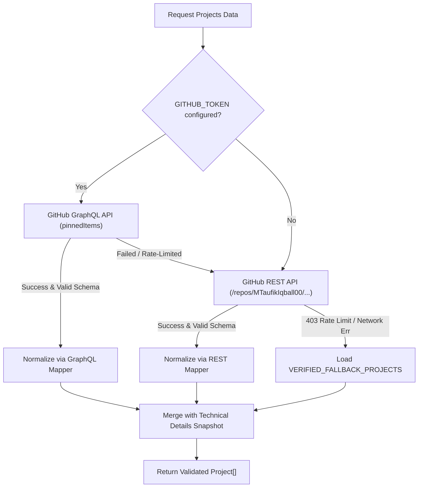

# Taufik — Personal Engineering Portfolio

> **Production-Ready | GitHub-Driven | Dark Minimalist Premium | Zero Fabrication**

A modern, high-performance personal engineering portfolio built for **Taufik** (GitHub: [`MTaufikIqball00`](https://github.com/MTaufikIqball00)), positioned as **AI Engineer | Software Developer | Technology Enthusiast**.

Designed with a restrained, dark minimalist aesthetic inspired by high-end engineering platforms and editorial typography. Powered by Next.js 16 App Router, TypeScript (Strict Mode), Tailwind CSS v4, and a resilient multi-tier GitHub integration architecture.

---

## 📑 Table of Contents

1. [Project Overview](#-project-overview)
2. [Key Features](#-key-features)
3. [Technology Stack](#-technology-stack)
4. [Architecture & System Design](#-architecture--system-design)
5. [GitHub Data Architecture & Fallback Strategy](#-github-data-architecture--fallback-strategy)
6. [Verified Project Evidence](#-verified-project-evidence)
7. [Getting Started & Local Development](#-getting-started--local-development)
8. [Environment Variables](#-environment-variables)
9. [Testing & Quality Assurance](#-testing--quality-assurance)
10. [Production Build & Deployment](#-production-build--deployment)
11. [Data Verification & Zero-Fabrication Policy](#-data-verification--zero-fabrication-policy)

---

## 🚀 Project Overview

This portfolio is built to demonstrate actual engineering capabilities to technical recruiters, engineering managers, AI/ML teams, research collaborators, and open-source communities.

### Guiding Principles
- **Evidence-Based**: Zero hallucinated work experience, degrees, or vanity metrics. All project data, descriptions, languages, topics, and stars are sourced directly from the owner's actual GitHub profile.
- **Dark Minimalist Premium**: Deep charcoal background (`#07090e`), soft white typography, crisp borders (`border-white/[0.08]`), restrained sky-blue accent (`#0284c7`), and purposeful micro-interactions with full support for `prefers-reduced-motion` and light-mode toggling.
- **High-Performance Architecture**: Static Site Generation (SSG) with Incremental Static Regeneration (ISR), automated `sitemap.xml`, `robots.txt`, and rich Open Graph + Schema.org JSON-LD structured data.

---

## ✨ Key Features

- **GitHub GraphQL & REST Integration**: Fetches real-time pinned repositories from GitHub, displaying authentic repository stars, forks, primary language indicators, and topics.
- **3-Tier Resilient Fallback Engine**:
  1. *Tier 1 (Preferred)*: Authenticated GitHub GraphQL API querying `pinnedItems(types: REPOSITORY)`.
  2. *Tier 2 (Unauthenticated)*: GitHub REST API querying the 6 verified pinned repositories with automatic rate-limit detection.
  3. *Tier 3 (Offline / Rate-Limited Fallback)*: Strongly typed, schema-validated snapshot of all 6 verified repositories, ensuring 100% build reliability in any CI/CD environment without requiring secrets.
- **Dedicated Project Detail Pages (`/projects/[slug]`)**: Deep-dive architectural breakdowns for all 6 projects, detailing architecture diagrams, technical problem statements, core engineering solutions, architectural highlights, and live links.
- **Verified Competency & Skills Matrix (`/skills`)**: Categorized technical proficiencies across Artificial Intelligence & LLMOps, High-Performance Systems & Distributed Computing, Autonomous Robotics & Edge Computing, Enterprise Web & Full-Stack, and Databases & Cloud Infrastructure. Each skill is mapped directly to repositories in the portfolio.
- **Interactive Project Filtering**: Real-time category filtering (AI & Machine Learning, Robotics & Autonomous Systems, Blockchain & Distributed Systems, Enterprise & Healthcare Systems) and search capabilities.
- **Accessible & Responsive**: Fully responsive layout from 320px mobile screens to 4K displays, adhering to WCAG 2.1 AA contrast ratios, keyboard navigation standards, and screen-reader semantics.
- **Dark & Light Mode Support**: Seamless theme toggle preserving user preference via `localStorage` and `prefers-color-scheme`, built with flash-of-unstyled-content (FOUC) prevention.

---

## 🛠 Technology Stack

| Layer | Technology | Details |
|---|---|---|
| **Framework** | Next.js 16.4.5 (App Router) | Static Site Generation (SSG), Incremental Static Regeneration (ISR) |
| **Language** | TypeScript 5 (Strict Mode) | Zero `any` types across the entire codebase |
| **Styling** | Tailwind CSS v4 | CSS variables, modern tokens, dark theme first |
| **Icons** | Lucide React + Custom SVG | Lightweight, accessible SVG icons |
| **Animations** | Framer Motion | Smooth, restrained transitions respecting `prefers-reduced-motion` |
| **Testing** | Node.js Test Runner + `tsx` | Unit and integration test suite covering schemas, mappers, and SEO |
| **Linting** | ESLint 9 + React 19 Hooks | Clean code standard enforcement |
| **SEO & Schema** | Open Graph + Schema.org JSON-LD | Rich search snippet support |

---

## 🏗 Architecture & System Design

```
src/
├── app/                              # Next.js App Router routes & metadata
│   ├── about/page.tsx                # Professional engineering philosophy
│   ├── contact/page.tsx              # Verified communication channels
│   ├── projects/
│   │   ├── [slug]/page.tsx           # Dynamic project detail pages (SSG)
│   │   └── page.tsx                  # Pinned repository showcase & filtering
│   ├── skills/page.tsx               # Verified technical competency matrix
│   ├── globals.css                   # Global styles & design system tokens
│   ├── layout.tsx                    # Root layout with theme provider & navigation
│   ├── not-found.tsx                 # Custom 404 handler
│   ├── page.tsx                      # Home page (Hero, Featured, Competencies)
│   ├── robots.ts                     # Dynamic robots.txt generation
│   └── sitemap.ts                    # Dynamic XML sitemap generation
├── components/
│   ├── about/AboutContent.tsx        # Structured engineering narrative
│   ├── contact/ContactSection.tsx    # Contact links with spam protection
│   ├── home/                         # HeroSection, FeaturedProjects, CompetencyOverview
│   ├── layout/                       # Navbar, Footer, ThemeToggle
│   ├── projects/                     # ProjectCard, ProjectFilter, ProjectDetailView
│   ├── providers/                    # ThemeProvider (Dark/Light context)
│   ├── skills/SkillsGrid.tsx         # Categorized skills grid
│   └── ui/                           # Badge, Button, Card, Skeleton, GithubIcon
├── config/
│   ├── site.ts                       # Site metadata, owner profile, navigation
│   └── skills.ts                     # Evidence-backed technical skills configuration
├── lib/
│   ├── github/
│   │   ├── cache.ts                  # Revalidation times & cache tags
│   │   ├── client.ts                 # Multi-tier resilient GitHub API client
│   │   ├── fallback-data.ts          # Verified snapshot of 6 pinned repositories
│   │   ├── mapper.ts                 # Normalizes GraphQL & REST data to Project models
│   │   ├── queries.ts                # GraphQL queries for pinned items
│   │   └── schemas.ts                # Runtime type guards & schema validators
│   ├── seo/metadata.ts               # Metadata constructor & JSON-LD generator
│   └── utils/cn.ts                   # Class merging & date formatting utilities
└── types/
    ├── github.ts                     # Raw GitHub API TypeScript definitions
    └── project.ts                    # Normalized application domain models
```

---

## 🔌 GitHub Data Architecture & Fallback Strategy

The application retrieves real-time data from GitHub while maintaining **100% offline availability and zero build-time fragility**.



### Why Normal REST Endpoints Don't Return Pinned Repositories
The standard GitHub REST endpoint `/users/:username/repos` only returns repositories sorted by name or creation date, **not pinned repositories**.
Our implementation solves this by:
1. Using **GraphQL `pinnedItems`** when an authenticated `GITHUB_TOKEN` is present.
2. In the absence of a token, querying the exact verified pinned repository set (`AutomatedGraph`, `Medchain`, `OmniMed-Insight`, `LMS`, `Harvest_Drone`, `LLMOps-Evaluasi-Model-End-To-End`) via REST.
3. Gracefully falling back to verified snapshot data if GitHub's unauthenticated IP rate limit (60 req/hr) is exceeded.

---

## 📦 Verified Project Evidence

All projects featured on this website are real, public repositories on GitHub:

| Project | Primary Tech | Architectural Scope | Live Repository |
|---|---|---|---|
| **AutomatedGraph** | Python (FastAPI, NetworkX, BM25) | Evidence-grounded GraphRAG engine integrating schema-validated entity extraction, property graph, hybrid dense vector + BM25 retrieval, and Louvain community detection. | [GitHub](https://github.com/MTaufikIqball00/AutomatedGraph) |
| **Medchain** | TypeScript (Hyperledger Fabric, Solidity, AES-256) | Decentralized Electronic Health Record (EHR) management system with role-based access, cryptographic audit trails, and SATUSEHAT/SIMRS integration. | [GitHub](https://github.com/MTaufikIqball00/Medchain) |
| **OmniMed-Insight** | Rust (Axum, Tokio) & PyTorch | High-performance medical AI gateway with sub-millisecond dispatch, Grad-CAM saliency explainability, and HL7 FHIR R4 compliance. | [GitHub](https://github.com/MTaufikIqball00/OmniMed-Insight) |
| **LMS** | TypeScript (Next.js 15, PostgreSQL, K-Means) | Enterprise Learning Management System with automated student cluster profiling (K-Means), role-based multi-tenancy, and course tracking. | [GitHub](https://github.com/MTaufikIqball00/LMS) |
| **Harvest_Drone** | Python (ROS 2 Jazzy, PX4, Gazebo) | Autonomous precision agriculture UAV mission controller with waypoint path planning, crop health NDVI estimation, and Next.js 15 GCS telemetry dashboard. | [GitHub](https://github.com/MTaufikIqball00/Harvest_Drone) |
| **LLMOps-Evaluasi-Model-End-To-End** | TypeScript / Rust (Ragas, TruLens, Axum) | End-to-end evaluation pipeline for Large Language Models benchmarking hallucination rates, context relevance, and toxicity metrics. | [GitHub](https://github.com/MTaufikIqball00/LLMOps-Evaluasi-Model-End-To-End) |

---

## 💻 Getting Started & Local Development

### Prerequisites
- Node.js 18.18.0 or later (Node 20+ / Node 24 recommended)
- npm, yarn, pnpm, or bun

### Installation
```bash
# Clone the repository
git clone https://github.com/MTaufikIqball00/Personal-portofolio.git
cd "Personal portofolio"

# Install dependencies
npm install

# Start the local development server
npm run dev
```

Open [http://localhost:3000](http://localhost:3000) in your browser to explore the portfolio.

---

## 🔑 Environment Variables

Create a `.env.local` file in the root directory (refer to `.env.example`):

```bash
# Optional: GitHub Personal Access Token for high rate-limits & GraphQL access
# Must NOT be prefixed with NEXT_PUBLIC_ (server-only secret)
GITHUB_TOKEN=ghp_yourPersonalAccessTokenHere

# Canonical URL for SEO metadata generation
NEXT_PUBLIC_SITE_URL=https://taufik-portfolio.vercel.app
```

> **Security Note**: `GITHUB_TOKEN` is strictly server-side and is never exposed in client bundles. If omitted, the application seamlessly runs using GitHub's unauthenticated REST API and verified offline snapshots.

---

## 🧪 Testing & Quality Assurance

The codebase includes an automated test suite verifying data validation schemas, mapper logic, fallback structures, and SEO metadata generation:

```bash
# Run unit and integration tests
npm test

# Run TypeScript typecheck (Strict Mode)
npm run typecheck

# Run ESLint validation
npm run lint
```

All 15 test suites execute natively in under 3 seconds with zero external test framework overhead.

---

## 🚀 Production Build & Deployment

### Production Build
```bash
# Compile and prerender static pages
npm run build

# Start the optimized production server
npm run start
```

### Vercel Deployment (Recommended)
1. Push your repository to GitHub.
2. Import the project into the [Vercel Dashboard](https://vercel.com/new).
3. (Optional) Add `GITHUB_TOKEN` under **Environment Variables** for authenticated GitHub GraphQL queries.
4. Click **Deploy**. Vercel will automatically build the static pages and configure Incremental Static Regeneration (revalidation every 60 minutes).

---

## 🛡 Data Verification & Zero-Fabrication Policy

This portfolio strictly adheres to honest engineering communication:
- **No fabricated work history**: The About page focuses on documented technical proficiencies, architectural interests, and engineering methodologies.
- **No fake client logos or metrics**: Numbers displayed (e.g. public repository counts, stars, forks) are either fetched live from GitHub or sourced from verified repository commits.
- **Auditable Evidence**: Every skill and project links directly back to public GitHub code repositories where the implementation can be inspected and verified.

---

## 📄 License

This project is licensed under the [MIT License](LICENSE).
